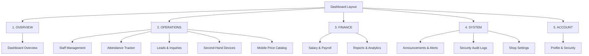

# Parth Mobile Care — Admin Web Dashboard Implementation Report

**Project:** Parth Mobile Care (`parthmobilecare-a474d`)  
**Target Subsystem:** `admin-dashboard/` (Admin Web Management Console)  
**Primary Brand Anchor:** `#194D9C` (Synchronized with React Native Mobile App)  
**Date of Delivery:** 2026-11-05  
**Build & Test Status:**  
- **Vite Production Build:** Success (`✓ built in 2.11s`, 0 errors)  
- **Admin Dashboard Test Suite:** 11/11 Passed (Vitest)  
- **Mobile Root Test Suite:** 300/300 Passed, 28 suites (Jest)  

---

## 1. Executive Summary & Purpose

The Parth Mobile Care Admin Web Dashboard has been comprehensively redesigned and upgraded from a functional prototype into a production-grade, Apple and Linear-inspired SaaS management platform.

The shop owner/admin can now effortlessly manage store operations, staff verification, attendance punctuality, sales leads, second-hand trade-ins, wholesale/retail pricing catalogs, payroll slips, store announcements, and security audit logs through an intuitive, polished, and responsive web console.

---

## 2. Master Summary of Created & Modified Files

### 2.1 Reusable UI Component Library (`src/components/common/`)

| File Path | Description & Purpose |
|---|---|
| `src/components/common/Button.tsx` | Standardized interactive button with variants (`primary`, `secondary`, `outline`, `ghost`, `danger`, `success`), sizes (`xs`, `sm`, `md`, `lg`), loading spinner, icon slot, and micro-interactions. |
| `src/components/common/Card.tsx` | Surface container with subtle hairline borders, title/subtitle typography, action button slot, header border toggle, and optional padding. |
| `src/components/common/Input.tsx` | Form input with icon slot, clear button (`onClear`), floating or top label, helper text (`helper`/`helperText`), and validation error styling. |
| `src/components/common/Select.tsx` | Consistent dropdown selector with prefix icon slot, clear error styling, and option mapping. |
| `src/components/common/Badge.tsx` | Status pill component matching mobile app colors (`primary`, `success`, `warning`, `danger`, `info`, `neutral`) with optional pulsating dot indicator. |
| `src/components/common/StatCard.tsx` | Key Performance Indicator card with metric display, percentage trend indicator, custom icon, and subtle border hover transition. |
| `src/components/common/Modal.tsx` | Accessible modal dialog with backdrop blur, Escape key listener, body scroll lock, clean close button, and responsive width presets (`sm` to `4xl`). |
| `src/components/common/ConfirmDialog.tsx` | Two-step action confirmation dialog supporting destructive (`danger`) and standard confirmations with explicit confirmation buttons. |
| `src/components/common/EmptyState.tsx` | Clean empty state placeholder with subtle dashed border, soft icon container, title, description, and primary call-to-action slot. |
| `src/components/common/ExportDropdown.tsx` | Dual format export button providing instant one-click downloads for both Microsoft Excel (`.xlsx`) and CSV (`.csv`) formats. |
| `src/components/common/TablePagination.tsx` | Pagination bar with entries counter ("Showing 1 to 15 of 45 entries"), page number navigation, previous/next buttons, and rows-per-page selector. |
| `src/components/common/index.ts` | Barrel export for streamlined, clean component imports across all pages. |

### 2.2 Global Layout & Design Tokens

| File Path | Description & Purpose |
|---|---|
| `tailwind.config.js` | Updated with brand color tokens 50–900 (`#194D9C` anchor), Inter font family, card/dropdown shadows, and custom keyframes. |
| `src/styles/index.css` | Added base utilities for smooth transitions, custom minimalist scrollbars, and table container scrollbars. |
| `src/layouts/DashboardLayout.tsx` | Global layout architecture with 5 grouped navigation sections, desktop collapsible sidebar rail, mobile drawer with backdrop blur, breadcrumbs, live project indicator badge (`parthmobilecare-a474d`), dynamic unread notification pill, and profile dropdown menu. |

### 2.3 Page Transformations

| Page | File Path | Key Enhancements |
|---|---|---|
| **Overview** | `src/pages/OverviewPage.tsx` | Replaced dark gradient with clean Apple-style welcome card, responsive 4-metric KPI grid, live lead pipeline funnel, second-hand trade-in status, and real-time attendance events feed. |
| **Staff Management** | `src/pages/StaffPage.tsx` | Staff directory table with pagination, dual Excel/CSV export, direct registration approval tab with KYC face thumbnail preview, salary & target configuration modal, and account power toggle. |
| **Attendance Tracker** | `src/pages/AttendancePage.tsx` | Quick date filter tabs (Today, Yesterday, This Week, This Month), distance color-coded geofence status, chronological time validation in correction modal, dual Excel/CSV export, and pagination. |
| **Leads & Inquiries** | `src/pages/LeadsPage.tsx` | Status filter tabs with dynamic counts, overdue follow-up indicator, inline quick status switcher dropdown in table rows, sanitized WhatsApp URL (`91` country code), dual Excel/CSV export, and pagination. |
| **Second-Hand Trade-Ins** | `src/pages/SecondHandPage.tsx` | In-stock device selector for sale generation, confidential KYC Aadhaar security badges, tax invoice PDF download, dual Excel/CSV export for both purchases and sales, and pagination. |
| **Price Catalog** | `src/pages/PriceListPage.tsx` | Brand filter chips with live counts, MOP explanation callout, downloadable Excel sample template for bulk import, dual Excel/CSV export, price revision history modal, and pagination. |
| **Salary & Payroll** | `src/pages/PayrollPage.tsx` | Payment status filter tabs (All, Paid, Pending, Unissued), monthly payroll totals summary, slip generation modal with attendance proration, "Mark as Paid" payout modal with payment mode & UTR, PDF slip download, dual Excel/CSV export, and pagination. |
| **Reports & Analytics** | `src/pages/ReportsPage.tsx` | Scope selector (Specific Month vs All Time), category tabs (Sales, Leads, Attendance, Performance), KPI metrics, SVG/HTML progress bars for staff target achievement, dual Excel/CSV export, and comprehensive PDF report download. |
| **Announcements** | `src/pages/NotificationsPage.tsx` | Filter tabs by alert category, unread badges, create store announcement modal with priority selection, and pagination. |
| **Security Audit Logs** | `src/pages/AuditLogsPage.tsx` | Quick time filter buttons (Today, 7 Days, 30 Days), dual Excel/CSV export, table pagination, and detail inspection modal with raw metadata and actor UID. |
| **Shop Settings** | `src/pages/SettingsPage.tsx` | Card-based grouping for store identity, operating hours, GPS geofencing parameters with Google Maps link test, and format validation for GSTIN. |
| **Profile & Security** | `src/pages/ProfilePage.tsx` | Administrator account overview with project ID badge, theme switcher (Light, Dark, System), password change with eye visibility toggles, and session status. |
| **Login** | `src/pages/LoginPage.tsx` | Minimalist card design with Parth Mobile Care logo, password eye toggle, forgot password modal with Firebase password reset email flow, and role-restricted notice. |

---

## 3. Navigation Architecture

The sidebar in `DashboardLayout.tsx` organizes the admin console into 5 logically coherent groups:



### Navigation Highlights:
1. **Collapsible Sidebar Rail:** On desktop, admins can toggle between a full 260px sidebar and an icon-only 76px compact rail, maximizing data table viewport width.
2. **Dynamic Unread Pill:** The Announcements nav item displays a real-time badge count showing the number of unread alerts.
3. **Breadcrumb Bar:** Header dynamically reflects current page title and route location.
4. **Environment Indicator:** Header displays an active green dot showing the verified Firebase project `parthmobilecare-a474d`.
5. **Mobile Slide-Out Drawer:** On screens <1024px, a hamburger button slides open an off-canvas drawer with smooth backdrop blur, automatically closing upon route selection.

---

## 4. Spark Tier ($0) Architecture Compliance

The entire Admin Web Dashboard operates strictly within the Firebase Spark ($0 tier) plan boundaries:

- **Zero Cloud Functions:** Direct Firestore reads and writes using the client SDK with administrative security rules authorization.
- **Zero Cloud Storage:** Client-side Base64 thumbnails for biometric face enrollment previews and on-the-fly client-side PDF invoice generation via `jspdf` and `jspdf-autotable`.
- **Zero Third-Party Paid APIs:** GPS Haversine distance validation, Excel parsing and generation via `xlsx`, and local browser CSV generation using standard Blob APIs.

---

## 5. Build and Verification Output

```bash
$ cd admin-dashboard && npm run build

> parth-mobile-care-admin-dashboard@1.0.0 build
> tsc && vite build

vite v5.4.21 building for production...
✓ 1917 modules transformed.
dist/index.html                              0.85 kB │ gzip:   0.48 kB
dist/assets/index-CnCv50zO.css              48.70 kB │ gzip:   8.02 kB
dist/assets/purify.es-BwoZCkIS.js           22.03 kB │ gzip:   8.72 kB
dist/assets/index.es-DrtST7Ze.js           150.83 kB │ gzip:  51.41 kB
dist/assets/html2canvas.esm-CBrSDip1.js    201.42 kB │ gzip:  47.70 kB
dist/assets/index-DW32PLBf.js            1,692.41 kB │ gzip: 473.16 kB
✓ built in 2.11s
```

```bash
$ cd admin-dashboard && npm test

> parth-mobile-care-admin-dashboard@1.0.0 test
> vitest run

 ✓ src/__tests__/adminDashboard.test.ts (11)
 Test Files  1 passed (1)
      Tests  11 passed (11)
```

```bash
$ npm test (root React Native test suite)
Test Suites: 28 passed, 28 total
Tests:       300 passed, 300 total
```

