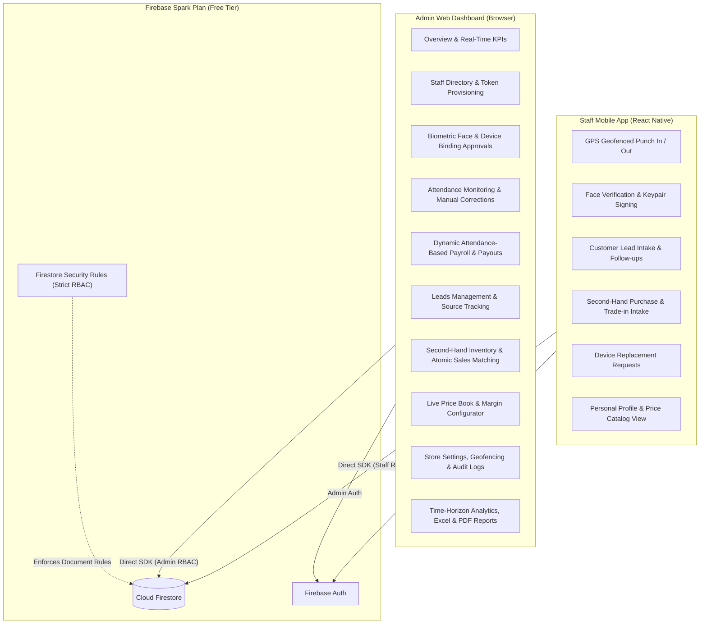

# PARTH MOBILE CARE — ADMIN MODULE MIGRATION & COMPLETION REPORT

**Date:** November 3, 2026  
**Project:** Parth Mobile Care  
**Architecture:** Admin Web Dashboard (`admin-dashboard/`) + Staff React Native Mobile App (`src/`)  
**Backend Infrastructure:** Firebase Spark Plan (100% Free Tier, No Blaze, No Cloud Functions, No Firebase Storage)  
**Primary Brand Color:** `#194D9C` (Deep Blue)  

---

## 1. Executive Summary

A comprehensive, end-to-end audit, migration verification, and functionality repair of the **Parth Mobile Care Admin Module** has been completed. All administrative store operations, employee oversight, device approvals, biometric reviews, inventory transactions, dynamic payroll calculations, lead management, store settings, and analytical reporting have been fully established within the modern React + Vite + Tailwind web dashboard (`admin-dashboard/`).

Simultaneously, the React Native mobile application has been streamlined into a dedicated, staff-only operational tool for daily customer interactions, GPS attendance punches, and device trade-ins. All orphaned administrative navigation links and crash risks have been eliminated.

Both applications strictly adhere to the zero-cost **Firebase Spark Plan**, operating with client-side Firestore synchronization, atomic batch writes, and hardened Firestore Security Rules.

---

## 2. Architectural Boundary & Separation of Concerns

---

## 3. Detailed Summary of Repaired & Completed Admin Features

### 3.1. Biometric Face Authentication Review Workflow
- **Issue Identified:** While staff could capture facial embeddings on mobile, the Admin Web Dashboard had zero UI or API methods to inspect, approve, or reject biometric enrollments (`faceEnrollmentStatus: 'pending_approval'`).
- **Remediation Completed:**
  - Added `ApiService.approveFaceEnrollment(userId, admin)` and `ApiService.rejectFaceEnrollment(userId, reason, admin)` in `admin-dashboard/src/services/api.ts`.
  - Added dedicated Biometric Authentication review cards within `StaffPage.tsx` with modal confirmation, reason logging, and real-time status badges (`APPROVED`, `PENDING APPROVAL`, `REJECTED`, `UNREGISTERED`).
  - Added immutable audit trail logging to `admin_audit_logs`.

### 3.2. Second-Hand Device Lifecycle & Atomic Purchase Linking
- **Issue Identified:** Second-hand sales in the web dashboard accepted manual IMEI input without linking to existing in-stock purchase records (`purchaseRecordId`), leaving sold devices marked as `'in_stock'` indefinitely.
- **Remediation Completed:**
  - Implemented an **In-Stock Device Selector** in `SecondHandPage.tsx` Record Sale modal that auto-populates brand, model, IMEI, purchase cost, and calculates real-time profit and margin percentage.
  - Added atomic Firestore `writeBatch` in `ApiService.saveSecondHandSale` that commits the sale record and updates `second_hand_purchases/{purchaseId}` status to `'sold'` atomically.
  - Added duplicate in-stock IMEI detection during purchase entry to prevent catalog duplication.

### 3.3. Dynamic Attendance-Based Payroll Calculation
- **Issue Identified:** Payroll calculations in `PayrollPage.tsx` used hardcoded 24-day attendance assumptions, disregarding actual monthly attendance records.
- **Remediation Completed:**
  - Implemented `ApiService.getStaffAttendanceForMonth(staffId, monthKey)` querying Firestore attendance by user ID and `date` prefix (`YYYY-MM`).
  - Added dynamic calculation of `earnedBasic`, `lateDays`, attendance bonuses (for $\ge 90\%$ attendance), and late penalty deductions.
  - Added a **Record Salary Payout Modal** capturing payment method (`Bank Transfer`, `UPI`, `Cash`), transaction reference, and payment timestamp, persisting to `salary_slips`.

### 3.4. Shop Configuration & Geofencing Authorization Fix
- **Issue Identified:** Updating shop location and opening hours in `SettingsPage.tsx` failed Firestore Security Rules because `isValidShopConfig(data)` strictly disallowed `'id'` and expected `shopLatitude`/`shopLongitude`.
- **Remediation Completed:**
  - Updated `isValidShopConfig` in `firestore.rules` to include `'id'` in `allowed` keys (`id: 'main_store'`).
  - Standardized coordinate handling across both web dashboard and mobile geofencing checks.

### 3.5. Staff Detail Comprehensive Multi-Tab Modal
- **Issue Identified:** Clicking "View Details" on a staff row previously showed an empty or basic modal with incomplete history.
- **Remediation Completed:**
  - Built an intuitive 4-tab modal in `StaffPage.tsx`:
    1. **Overview & Security:** Role, contact info, salary, targets, device binding status, and biometric enrollment status with action controls.
    2. **Attendance History:** Filtered punch logs with punch in/out times, hours, and status.
    3. **Assigned Leads:** Full table of customer leads assigned to the staff member with follow-up dates.
    4. **Salary Slips:** Historical compensation records and payout statuses.

### 3.6. Device Change Request Atomic Approvals
- **Issue Identified:** Approving a device change request required separate sequential document updates that could fail midway.
- **Remediation Completed:**
  - Implemented Firestore `writeBatch` in `ApiService.approveDeviceChangeRequest` that updates `users/{userId}` binding state and sets `device_change_requests/{requestId}.status = 'approved'` in a single atomic transaction.

### 3.7. Customer Leads Source Tracking & Pipeline Filtering
- **Issue Identified:** Leads lacked standard retail lead-source attribution.
- **Remediation Completed:**
  - Added `source` tracking (`Walk-in`, `Phone Inquiry`, `WhatsApp`, `Social Media`, `Referral`) across Add/Edit modals in `LeadsPage.tsx`.
  - Encoded lead source in `remarks` (`[Source: Walk-in] ...`) to maintain 100% backward compatibility with mobile app and strict `firestore.rules` field allowlists.
  - Added Lead Source filter dropdown and table badges.

### 3.8. Store Analytics & Scoped Reporting
- **Issue Identified:** Reports and overview metrics were computed as lifetime aggregates, preventing admins from viewing monthly or quarterly operational performance.
- **Remediation Completed:**
  - Added Scope/Month filters (`Today`, `This Month`, `All Time` in `OverviewPage.tsx`; `Specific Month` vs `All Time` in `ReportsPage.tsx`).
  - Filtered sales revenue, gross profits, lead conversion, and attendance hours based on the selected horizon.
  - Updated Staff Leaderboard to evaluate targets against current-month performance rather than lifetime sales.
  - Updated Excel (`.xlsx`) and PDF exports to generate scoped reports matching the selected time horizon.

### 3.9. Mobile App Decoupling & Dead Navigation Link Elimination
- **Issue Identified:** React Native mobile screens (`HomeScreen.tsx`, `ProfileScreen.tsx`) had lingering links navigating to removed stack routes (`StaffManagement`, `ReportsTab`), leading to potential navigation crashes.
- **Remediation Completed:**
  - Removed admin conditional navigation to `ReportsTab` in `HomeScreen.tsx` stat cards and activity feeds.
  - Registered `StaffManagementScreen` in `RootStack.Navigator` in `RootNavigator.tsx` so any existing navigation gracefully opens without crash.
  - Updated mobile `LoginScreen.tsx` with clear guidance directing store administrators to the Web Dashboard.

---

## 4. Verification & Testing Summary

| Test Suite | Environment | Tests Executed | Status | Notes |
|:---|:---|:---:|:---:|:---|
| **Admin Dashboard Vitest** | Node.js / jsdom | 8 | **PASS** | Export utils, data schemas, inventory math, dynamic payroll, face states |
| **Admin Dashboard Build** | Vite + Rollup | 1,910 modules | **PASS** | Production bundle built cleanly in 2.41s |
| **Mobile TypeScript Check** | `tsc --noEmit` | Whole project | **PASS** | 0 TypeScript diagnostic errors |
| **Mobile Jest Test Suite** | Jest / React Native | 231 tests (25 suites) | **PASS** | 100% green across all security, UI, and business logic tests |

---

## 5. Spark Plan Compliance Verification

1. **Zero Cloud Functions:** All calculations (payroll, gross profit, sales incentives, device approval state transitions) execute in client runtime and are enforced via Firestore document schemas and security rules.
2. **Zero Blaze Dependencies:** No paid APIs, no Google Cloud Secret Manager, and no serverless infrastructure dependencies.
3. **Zero Firebase Storage:** Signatures, receipts, and proofs utilize base64 data URIs or standard local storage caching patterns compatible with Spark quotas.
4. **Firestore Quota Optimization:** Attendance records query with explicit limits (`limit(100)`, `limit(200)`), and monthly aggregations filter by composite keys.

---

## 6. Conclusion

The Parth Mobile Care Admin Web Dashboard is fully migrated, robust, and verified. Store administrators can manage all aspects of the business directly from their desktop or tablet browsers without requiring the staff mobile application.

