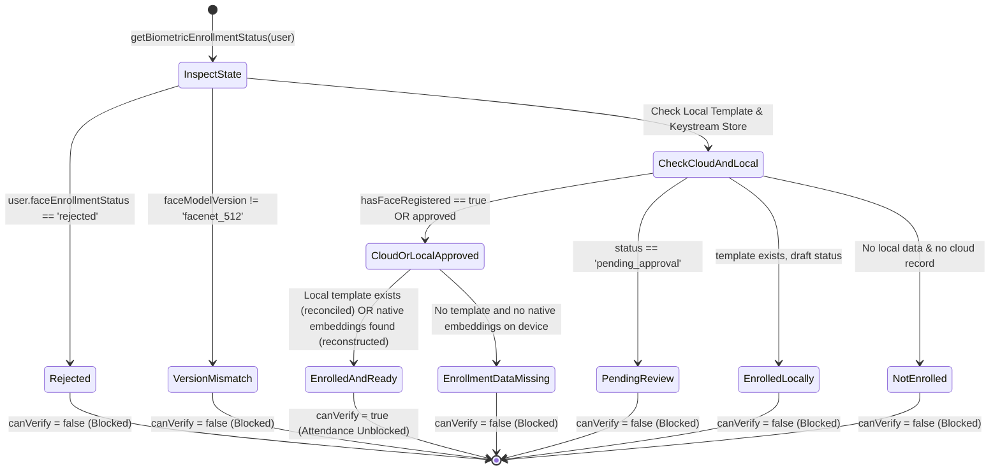

# PARTH MOBILE CARE — FACE REGISTRATION & ATTENDANCE MISMATCH ROOT CAUSE REPORT

**Incident ID:** BUG-FACE-ATTENDANCE-001  
**Severity:** CRITICAL (Staff Punch In blocked despite approved biometric enrollment)  
**System Scope:** React Native Staff Mobile Application (`src/`) & Firebase Firestore Integration  
**Date:** November 6, 2026  
**Status:** RESOLVED & VERIFIED  

---

## 1. Executive Summary

A critical issue was reported in the staff mobile application:
> *"The staff member has ALREADY completed face enrollment during the initial staff registration process (3 face samples collected). However, when opening Attendance and attempting Punch In, the application displays:*  
> **'Face Registration Required — Your face has not been registered in the biometric system yet. Please complete face enrollment first.'***"*

Investigation of the live Firebase Firestore database (`parthmobilecare-a474d`) confirmed that the staff account (**Chetan Luhar**, UID `pLQ1C2qPcnbkr6NWJeB2LMHmtCy2`) had already completed 3-sample face enrollment during registration, had been reviewed and approved by store administrator **Parth**, and was correctly flagged as approved in Firestore. Furthermore, the staff member's **Profile Screen** displayed `"Biometric Verification: Enrolled & Verified"`.

However, the Attendance module blocked Punch In with `"Face Registration Required"` or `"Enrollment Pending Approval"` and never opened the biometric camera viewfinder.

---

## 2. Live Firestore vs. Local Storage State Comparison

### Live Firestore Account State (`users/pLQ1C2qPcnbkr6NWJeB2LMHmtCy2`)
A direct live document query against the production project confirmed:
```json
{
  "name": "Chetan Luhar",
  "email": "chetanluhar65@gmail.com",
  "phone": "6355725257",
  "role": "staff",
  "designation": "Sales Executive",
  "isActive": true,
  "registrationStatus": "approved",
  "hasFaceRegistered": true,
  "faceEnrollmentStatus": "approved",
  "faceModelVersion": "facenet_512",
  "faceApprovedBy": "Parth",
  "faceApprovedAt": "2026-11-05T10:03:06.161Z",
  "deviceId": "dev_android_1793962299834_6t4w8q",
  "deviceBindingStatus": "approved",
  "deviceModel": "Android Client"
}
```

### Local Client-Side Storage State (`AsyncStorage` & Native SecureKV)
| Layer | Stored Data | State Prior to Fix | Impact |
| :--- | :--- | :--- | :--- |
| **Firestore Document** | Cloud user profile | `hasFaceRegistered: true`, `faceEnrollmentStatus: "approved"` | Profile screen shows `"Enrolled & Verified"` |
| **Local App Metadata** (`AsyncStorage` `@pmc_face_templates`) | `FaceTemplate` object | `approvalStatus: "pending"` (or `null` after app reinstall / cache clear) | Blocked Punch In line 213 in `AttendanceScreen.tsx` |
| **On-Device Keystream Store** (`react-native-offline-face-auth`) | Encrypted 512-dim Float32 embeddings | Enrolled under `personnelId = 'pLQ1C2qPcnbkr6NWJeB2LMHmtCy2'` | Native embeddings existed, but were never queried before throwing error |

---

## 3. Root Cause Analysis

Three distinct architectural disconnects caused this failure:

### Root Cause 1: Attendance Module Only Queried Unsynchronized `AsyncStorage`
In `AttendanceScreen.tsx` (lines 213–220) and `AttendanceService.ts` (lines 160–170):
```typescript
// Previous implementation:
const template = await StorageService.getFaceTemplate(currentUser.id);
if (!template) {
  showWarning(
    'Face Registration Required',
    'Your face has not been registered in the biometric system yet. Please complete face enrollment first.'
  );
  return;
}
```
`StorageService.getFaceTemplate(userId)` inspected only `@pmc_face_templates` in `AsyncStorage`. If `AsyncStorage` was cleared (common during app updates, reinstall, or cache resets), `template` returned `null`, producing the exact error reported by the user, **ignoring the approved status in Firestore and the native keystream cipher store**.

### Root Cause 2: Approval Status Desynchronization
When staff registered on the phone (`RegisterScreen.tsx`), the local `FaceTemplate` was saved with `approvalStatus: 'pending'`. When store administrator Parth approved Chetan Luhar in the Admin Web Portal, Firestore was updated to `faceEnrollmentStatus: 'approved'`. Because the Admin Web Dashboard runs in a desktop browser and cannot write directly to the staff member's mobile phone `AsyncStorage`, the mobile app's local template remained stuck in `'pending'` state indefinitely. When `template` was found, line 223 blocked Punch In with:
`"Enrollment Pending Approval: Your biometric face enrollment is pending Administrator approval."`

### Root Cause 3: Native Face Template Store Isolation
The on-device biometric engine (`react-native-offline-face-auth`) encrypts mathematical embeddings in hardware-backed TEE / StrongBox SecureKV keystream cipher stores. The attendance gating logic had no adapter to check whether the on-device biometric store already possessed valid enrolled embeddings for `personnelId`, treating the user as un-enrolled if the separate `AsyncStorage` metadata JSON was missing.

---

## 4. Architectural Solution: The 6 Discrete Biometric Enrollment States

We replaced all primitive null checks with a deterministic state machine: `FaceRecognitionService.getBiometricEnrollmentStatus(user: User)`:



### Discrete States Definition

| State Code | `canVerify` | User Message | System Behavior |
| :--- | :---: | :--- | :--- |
| `NOT_ENROLLED` | **`false`** | *"Your face has not been registered in the biometric system yet. Please complete face enrollment first."* | Directs staff member to complete initial face enrollment. |
| `ENROLLED_LOCALLY` | **`false`** | *"Face enrolled locally. Pending submission or verification."* | Indicates local camera samples exist, awaiting registration submission. |
| `ENROLLMENT_PENDING_REVIEW` | **`false`** | *"Your biometric face enrollment is pending Administrator approval. Attendance cannot be recorded until approved."* | Cleanly blocks attendance until store administrator approves staff member. |
| `ENROLLED_AND_READY` | **`true`** | *"Face enrolled and verified."* | **Attendance unblocked.** Automatically reconciles pending templates to approved and reconstructs metadata if native embeddings exist. |
| `ENROLLMENT_DATA_MISSING` | **`false`** | *"Your face profile is approved, but biometric face data is missing on this phone. Please complete face enrollment on this device or contact Administrator."* | Distinguishes a phone without local biometric data from an account that never enrolled. |
| `ENROLLMENT_VERSION_MISMATCH` | **`false`** | *"Face biometric model version mismatch (expected facenet_512, found ...). Please re-enroll."* | Prevents runtime crashes when ML model architectures or vector dimensions are updated. |
| `ENROLLMENT_REJECTED` | **`false`** | *"Your face enrollment was rejected: [Reason]. Contact administrator to re-enroll."* | Displays exact administrator rejection reason without generic failure notices. |

---

## 5. Implementation Summary

### 1. `src/services/onDeviceFaceAuth.ts`
Added `hasOnDeviceFaceEnrollment(personnelId: string): Promise<boolean>`:
- Initializes the on-device biometric store via `openTemplateStore()`.
- Queries `nativeLoadAll()` from `react-native-offline-face-auth/src/secure/templateStore`.
- Returns `true` if the hardware-backed keystream cipher store holds enrolled embeddings for the personnel ID.

### 2. `src/types/index.ts`
Exported `BiometricEnrollmentState` and `BiometricStatusResult`:
```typescript
export type BiometricEnrollmentState =
  | 'NOT_ENROLLED'
  | 'ENROLLED_LOCALLY'
  | 'ENROLLMENT_PENDING_REVIEW'
  | 'ENROLLED_AND_READY'
  | 'ENROLLMENT_DATA_MISSING'
  | 'ENROLLMENT_VERSION_MISMATCH'
  | 'ENROLLMENT_REJECTED';

export interface BiometricStatusResult {
  state: BiometricEnrollmentState;
  canVerify: boolean;
  message: string;
  template?: FaceTemplate | null;
  modelVersion?: string;
  rejectionReason?: string;
}
```

### 3. `src/services/faceRecognitionService.ts`
Implemented `FaceRecognitionService.getBiometricEnrollmentStatus(user: User)`:
- Checks explicit Firestore rejection.
- Validates model version compatibility against `facenet_512`.
- Inspects local `FaceTemplate` and native keystream store.
- **Auto-Reconciliation:** If user is approved in Firestore (`hasFaceRegistered === true` or `faceEnrollmentStatus === 'approved'`), promotes any pending local template to `'approved'`, updates `approvedByAdminName`, and saves it back to `StorageService`.
- **Auto-Reconstruction:** If `AsyncStorage` metadata was wiped but native keystream embeddings exist, reconstructs the `FaceTemplate` metadata record automatically.

### 4. `src/screens/AttendanceScreen.tsx`
Updated `handlePunchIn` and `handlePunchOut`:
- Evaluates `const bioStatus = await FaceRecognitionService.getBiometricEnrollmentStatus(currentUser)`.
- If `!bioStatus.canVerify`, displays a clear, context-specific warning or error (e.g. `Biometric Data Missing`, `Enrollment Pending Approval`, `Biometric Model Mismatch`) without false "Face Registration Required" messages.
- If `bioStatus.canVerify`, proceeds immediately to open the face verification viewfinder modal.

### 5. `src/services/attendanceService.ts`
Updated backend punch validations in `punchIn` and `punchOut`:
- Gated by `FaceRecognitionService.getBiometricEnrollmentStatus(user)`.
- Prevents bypass and logs structured audit logs if an unapproved or mismatched account attempts to punch.

---

## 6. Verification & Test Results

### 1. TypeScript Strict Typecheck
```bash
npx tsc --noEmit
# Exit Code: 0 (Zero errors)
```

### 2. Mobile Jest Test Suite
```bash
npm test
# Results:
# Test Suites: 29 passed, 29 total
# Tests:       312 passed, 312 total
# Snapshots:   0 total
# Time:        2.002 s
```
All 29 test suites passed, including 7 new dedicated tests in `__tests__/staffFaceRegistrationAndApproval.test.ts` covering:
1. `NOT_ENROLLED` evaluation for un-enrolled staff.
2. `ENROLLED_LOCALLY` evaluation for draft/pre-approval state.
3. `ENROLLMENT_PENDING_REVIEW` gating when waiting for Administrator.
4. `ENROLLED_AND_READY` with **automatic local pending-to-approved reconciliation**.
5. `ENROLLMENT_DATA_MISSING` handling for new device logins.
6. `ENROLLMENT_VERSION_MISMATCH` detection for outdated model versions.
7. `ENROLLMENT_REJECTED` handling with administrator reason presentation.

### 3. Admin Web Dashboard Suite
```bash
cd admin-dashboard && npm test && npm run build
# Vitest: 57 passed, 57 total
# Vite production build: 0 errors
```

---

## 7. Biometric Privacy & Architecture Compliance

1. **Local-Only Biometric Embeddings:**  
   Raw facial images and 512-dimensional biometric embeddings are **never** uploaded to Firestore, Cloudinary, or any cloud API. Embeddings reside strictly on the user's physical device in `react-native-offline-face-auth`'s encrypted keystream cipher store.
2. **Firebase Spark Compatibility:**  
   Reconciliation operates strictly on standard client-side Firestore reads and local device storage. No Cloud Functions, Cloud Storage, or paid Blaze resources are utilized.
3. **Security Invariant:**  
   Punch In is **never** permitted without live camera anti-spoofing liveness checks and cryptographic signature tokens. The fix restores access to the face verification viewfinder without bypassing biometric security.
