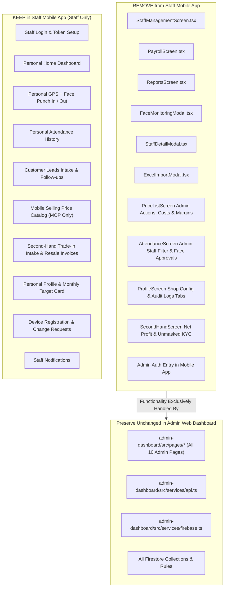

# PARTH MOBILE CARE — STAFF MOBILE APPLICATION ADMIN REMOVAL AUDIT

**Date:** November 3, 2026  
**Document Version:** 1.0  
**Project:** Parth Mobile Care  
**Scope:** Complete identification of all Admin-related code, screens, routes, components, and logic in the React Native mobile application (`src/`) and their disposal plan.  
**Constraint:** Admin functionality is NOT deleted from the project; it is preserved and operated exclusively within the Admin Web Dashboard (`admin-dashboard/`).  

---

## 1. Executive Summary

This audit catalogs every administrative screen, component, navigation route, quick action, service method, role condition, and business setting currently residing in the React Native mobile application (`src/`). 

In accordance with the project architecture transition:
1. **Admin Web Dashboard (`admin-dashboard/`)**: The sole, authoritative hub for all store management, staff administration, payroll calculations, price configuration, device/face approvals, second-hand gross margin analysis, geofencing settings, and analytical reporting.
2. **Staff Mobile Application (`src/`)**: A purpose-built, staff-only operational tool for attendance punch in/out (GPS + Face Auth), customer lead management, second-hand device intake/sales, and retail price consultation.

---

## 2. Inventory of Admin Modules in React Native Mobile Application

### 2.1. Screens Audit

| Screen File | Current Status & Capabilities | Decision | Replacement in Admin Web Dashboard |
|:---|:---|:---:|:---|
| [`src/screens/StaffManagementScreen.tsx`](file:///Users/chetan/ParthMobileCare/src/screens/StaffManagementScreen.tsx) | Complete Admin staff directory, staff invitation token generator, account deactivation/activation, device approval, face approval, sales target configuration, and salary setup (1,409 lines). | **REMOVE from mobile** | Handled by `admin-dashboard/src/pages/StaffPage.tsx` |
| [`src/screens/PayrollScreen.tsx`](file:///Users/chetan/ParthMobileCare/src/screens/PayrollScreen.tsx) | Admin payroll generator, monthly slip calculation, incentive calculator, and payout marking. | **REMOVE from mobile** | Handled by `admin-dashboard/src/pages/PayrollPage.tsx` |
| [`src/screens/ReportsScreen.tsx`](file:///Users/chetan/ParthMobileCare/src/screens/ReportsScreen.tsx) | Admin financial summary, revenue, cost of goods, gross margins, attendance statistics, Excel/PDF export engine (490 lines). | **REMOVE from mobile** | Handled by `admin-dashboard/src/pages/ReportsPage.tsx` |
| [`src/screens/AttendanceScreen.tsx`](file:///Users/chetan/ParthMobileCare/src/screens/AttendanceScreen.tsx) | Hybrid screen: Staff punch in/out and history, plus Admin staff selector (`allUsers`), admin face approval banner, and `FaceMonitoringModal`. | **PURGE Admin logic, KEEP Staff Punch** | Attendance monitoring & manual corrections handled by `admin-dashboard/src/pages/AttendancePage.tsx` |
| [`src/screens/PriceListScreen.tsx`](file:///Users/chetan/ParthMobileCare/src/screens/PriceListScreen.tsx) | Hybrid screen: Staff price catalog, plus Admin wholesale purchase costs (`purchasePrice`), profit margins (`marginPercent`), Edit/Delete actions, Add Model FAB, and Excel import modal. | **PURGE Admin controls, KEEP Staff Catalog** | Mobile price creation, wholesale cost management, and Excel import handled by `admin-dashboard/src/pages/PriceListPage.tsx` |
| [`src/screens/ProfileScreen.tsx`](file:///Users/chetan/ParthMobileCare/src/screens/ProfileScreen.tsx) | Hybrid screen: Staff personal profile and targets, plus Admin "Shop Settings" tab (geofence coords/hours), Admin "Audit Log" tab, and "Manage Staff" link. | **PURGE Admin tabs, KEEP Staff Profile** | Shop geofence & business settings handled by `admin-dashboard/src/pages/SettingsPage.tsx`; Audit logs by `admin-dashboard/src/pages/AuditLogsPage.tsx` |
| [`src/screens/SecondHandScreen.tsx`](file:///Users/chetan/ParthMobileCare/src/screens/SecondHandScreen.tsx) | Hybrid screen: Staff intake/sales entry, plus Admin "View KYC" modal, Net Profit column, and purchase cost disclosure. | **PURGE Admin columns, KEEP Staff Intake** | Second-hand profit analysis, inventory stock management, and atomic sales handled by `admin-dashboard/src/pages/SecondHandPage.tsx` |
| [`src/screens/HomeScreen.tsx`](file:///Users/chetan/ParthMobileCare/src/screens/HomeScreen.tsx) | Staff personal dashboard with residual `!isAdmin` conditional branching for leads and sales metrics. | **CLEANUP: Enforce Staff Scope Unconditionally** | Store-wide dashboard handled by `admin-dashboard/src/pages/OverviewPage.tsx` |
| [`src/screens/LoginScreen.tsx`](file:///Users/chetan/ParthMobileCare/src/screens/LoginScreen.tsx) | Staff login and invitation redemption modal. | **ENFORCE: Block Admin/Manager Access** | Admin signs in at web dashboard `LoginPage.tsx` |

---

### 2.2. Components Audit

| Component File | Role / Purpose | Decision | Web Equivalent |
|:---|:---|:---:|:---|
| [`src/components/FaceMonitoringModal.tsx`](file:///Users/chetan/ParthMobileCare/src/components/FaceMonitoringModal.tsx) | Admin modal to review and approve staff face recognition embeddings. | **REMOVE from mobile screens** | Built into `StaffPage.tsx` |
| [`src/components/StaffDetailModal.tsx`](file:///Users/chetan/ParthMobileCare/src/components/StaffDetailModal.tsx) | Admin modal to view staff profile, targets, device status, and attendance. | **REMOVE from mobile screens** | Built into `StaffPage.tsx` multi-tab modal |
| [`src/components/ExcelImportModal.tsx`](file:///Users/chetan/ParthMobileCare/src/components/ExcelImportModal.tsx) | Admin bulk price list spreadsheet importer. | **REMOVE from mobile screens** | Handled in `PriceListPage.tsx` |
| [`src/components/DeviceBindingModal.tsx`](file:///Users/chetan/ParthMobileCare/src/components/DeviceBindingModal.tsx) | Staff hardware binding registration and change request submission. | **PRESERVE** | Staff initiates; Admin approves on web |
| [`src/components/FaceRegistrationModal.tsx`](file:///Users/chetan/ParthMobileCare/src/components/FaceRegistrationModal.tsx) | Staff camera face enrollment modal. | **PRESERVE** | Staff captures; Admin approves on web |
| [`src/components/FaceVerificationModal.tsx`](file:///Users/chetan/ParthMobileCare/src/components/FaceVerificationModal.tsx) | Staff daily punch in/out face verification. | **PRESERVE** | Pure staff feature |
| [`src/components/OnDeviceFaceAuthView.tsx`](file:///Users/chetan/ParthMobileCare/src/components/OnDeviceFaceAuthView.tsx) | Staff on-device TFLite camera preview. | **PRESERVE** | Pure staff feature |
| [`src/components/DigitalSignaturePad.tsx`](file:///Users/chetan/ParthMobileCare/src/components/DigitalSignaturePad.tsx) | Canvas for customer trade-in signature. | **PRESERVE** | Staff second-hand intake requirement |
| [`src/components/DocumentCapture.tsx`](file:///Users/chetan/ParthMobileCare/src/components/DocumentCapture.tsx) | Camera capture for customer bills/Aadhaar. | **PRESERVE** | Staff second-hand intake requirement |

---

### 2.3. Navigation Routes Audit (`src/navigation/RootNavigator.tsx`)

| Route Name | Target Screen | Current Type | Decision |
|:---|:---|:---|:---:|
| `MainTabs` | Tab Navigator (`HomeTab`, `LeadsTab`, `PriceListTab`, `ProfileTab`) | Bottom Tabs | **PRESERVE** (Staff Only) |
| `HomeTab` | `HomeScreen` | Bottom Tab | **PRESERVE** |
| `LeadsTab` | `LeadListScreen` | Bottom Tab | **PRESERVE** |
| `PriceListTab` | `PriceListScreen` (Staff selling catalog only) | Bottom Tab | **PRESERVE** |
| `ProfileTab` | `ProfileScreen` (Personal staff profile only) | Bottom Tab | **PRESERVE** |
| `Attendance` / `AttendanceTab` | `AttendanceScreen` (Personal staff punches only) | Stack Screen | **PRESERVE** |
| `BuySell` / `BuySellTab` | `SecondHandScreen` (Staff intake and sales only) | Stack Screen | **PRESERVE** |
| `Notifications` | `NotificationsScreen` | Stack Screen | **PRESERVE** |
| `StaffManagement` | `StaffManagementScreen` | Stack Screen | **REMOVE** |
| `ReportsTab` / `Reports` | `ReportsScreen` | Unregistered / Legacy | **REMOVE permanently** |
| `Payroll` | `PayrollScreen` | Unregistered / Legacy | **REMOVE permanently** |

---

### 2.4. Services & Business Logic Audit (`src/services/`)

| Service File | Methods & Logic | Decision | Reason |
|:---|:---|:---:|:---|
| [`src/services/payrollService.ts`](file:///Users/chetan/ParthMobileCare/src/services/payrollService.ts) | Admin payroll generation, pro-rated formulas, salary slips, mark paid. | **DEPRECATE mobile usage** (Keep file for web/tests or remove mobile references) | Web dashboard has `getStaffAttendanceForMonth` and `saveSalarySlip` |
| [`src/services/reportExportService.ts`](file:///Users/chetan/ParthMobileCare/src/services/reportExportService.ts) | Admin PDF / Excel store operations report generation. | **DEPRECATE mobile usage** | Web dashboard generates official Excel (`.xlsx`) & PDF reports via `xlsx` & `jspdf` |
| [`src/services/auditService.ts`](file:///Users/chetan/ParthMobileCare/src/services/auditService.ts) | Administrative action logging and log fetching. | **DEPRECATE mobile usage** | Web dashboard has `logAdminAction` and `getAuditLogs` |
| [`src/services/excelService.ts`](file:///Users/chetan/ParthMobileCare/src/services/excelService.ts) | Mobile price list Excel import/export parser. | **DEPRECATE mobile usage** | Web dashboard manages price lists |
| [`src/services/staffProvisioningService.ts`](file:///Users/chetan/ParthMobileCare/src/services/staffProvisioningService.ts) | Staff invite generation (`createStaffInvitation`) and account status (`setStaffAccountStatus`) vs Staff token verification (`verifyInvitationToken`, `completeStaffSetup`). | **SPLIT: Keep Staff Token Setup, Remove Admin Management** | Staff uses token verification during onboarding; Admin provisions tokens on Web |
| [`src/services/attendanceService.ts`](file:///Users/chetan/ParthMobileCare/src/services/attendanceService.ts) | Punch in/out, GPS check, face score logging, monthly summary. | **PRESERVE (Staff Punch Engine)** | Pure staff feature |
| [`src/services/leadService.ts`](file:///Users/chetan/ParthMobileCare/src/services/leadService.ts) | Create lead, update lead, fetch assigned leads. | **PRESERVE (Staff Leads Engine)** | Pure staff feature |
| [`src/services/secondHandService.ts`](file:///Users/chetan/ParthMobileCare/src/services/secondHandService.ts) | Create purchase, create sale, search IMEI. | **PRESERVE (Staff Trade-in Engine)** | Pure staff feature |
| [`src/services/locationService.ts`](file:///Users/chetan/ParthMobileCare/src/services/locationService.ts) | Geolocation distance calculation against shop coordinates. | **PRESERVE** | Staff geofence punch requirement |
| [`src/services/faceRecognitionService.ts`](file:///Users/chetan/ParthMobileCare/src/services/faceRecognitionService.ts) | On-device TFLite mobile face recognition. | **PRESERVE** | Staff local face match |
| [`src/services/deviceBindingService.ts`](file:///Users/chetan/ParthMobileCare/src/services/deviceBindingService.ts) | Device keystore asymmetric key generation and signature. | **PRESERVE** | Staff device security |
| [`src/services/firestoreSync.ts`](file:///Users/chetan/ParthMobileCare/src/services/firestoreSync.ts) | Firestore real-time listeners and offline caching. | **PRESERVE** | Shared real-time sync |
| [`src/services/storageService.ts`](file:///Users/chetan/ParthMobileCare/src/services/storageService.ts) | MMKV / AsyncStorage local offline storage. | **PRESERVE** | Shared offline caching |

---

### 2.5. Authentication & Role-Based Access Control Audit (`src/context/AuthContext.tsx`)

| Checkpoint | Current Behavior | Required Staff-Only Behavior |
|:---|:---|:---|
| **Login (`login`)** | Accepts both Admin and Staff credentials. | If authenticated user's Firestore profile has `role === 'admin'` or `role === 'manager'`, immediately invoke `signOut()`, clear local storage, and reject with: `"Access Denied: Store administrators must use the Parth Mobile Care Admin Web Dashboard. This mobile app is exclusively for staff members."` |
| **App Startup (`acceptAuthUser`)** | Loads profile and pulls users collection if `profile.role === 'admin'`. | If `profile.role !== 'staff'`, immediately sign out, wipe cached user state, and throw an access-denied error. Never load staff collections or route into `MainTabs`. |
| **Account Status (`isActive`)** | Listens for `isActive === false` to terminate session. | **PRESERVE & ENFORCE:** If `isActive === false`, session is terminated immediately with account deactivation notice. |
| **Pending / Missing Profile** | Throws generic profile error. | Show clear message indicating profile is pending or awaiting invitation setup. |

---

## 3. Systematic Removal & Preservation Plan

---

## 4. Conclusion & Next Steps

This audit establishes a crisp, non-negotiable boundary:
- **Zero Admin operations in the mobile app.**
- **No confidential cost prices, margins, all-staff attendance, or store settings accessible to staff.**
- **Admin credentials blocked at the mobile authentication barrier.**
- **Admin Web Dashboard remains 100% functional and intact.**
- **Firebase data collections, Firestore security rules, and Spark free-tier architecture fully protected.**

